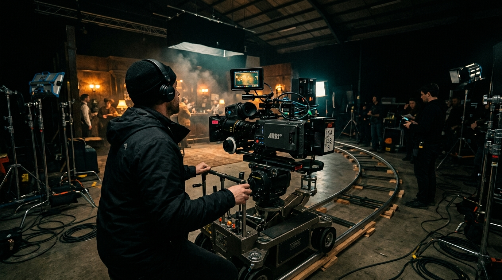

# NOIRFRAME — Cinematic Director & DP Portfolio

A luxury, interactive cinematography portfolio built with **Next.js 14**, **TypeScript**, **Tailwind CSS**, and **Framer Motion**. Features scroll-driven canvas frame sequencing, cinematic letterboxing, grain, vignette overlays, and an editorial dark aesthetic.



---

## ✨ Features

- **Continuous Scroll Frame Sequence**: 196-frame high-resolution sequence rendered on an HTML5 canvas with smooth scrub playback and DPR scaling.
- **Cinematic Atmosphere**: Film grain textures, anamorphic lens flare accents, subtle golden vignettes, and 2.39:1 aspect ratio cues.
- **Dedicated Project Showcase (`/work`)**: Complete showcase categorized into Feature Films, Fashion & Commercials, Music Videos, and Documentaries with technical camera/lens breakdowns.
- **Directing & DP Services (`/services`)**: Full production packages with day-rate transparency, gear kit specifications (ARRI Alexa 35, Cooke Anamorphic), and workflow timelines.
- **Seamless Navigation & Audio Mood**: Frosted glass floating navbar, soundscape mood indicator, and quick project booking modal.
- **Fully Responsive & Performance Tuned**: Preloaded keyframes, RAF throttled scroll handlers, and optimized Next.js layout structure.

---

## 🛠️ Tech Stack

- **Framework**: [Next.js 14](https://nextjs.org/) (App Router)
- **Language**: [TypeScript](https://www.typescriptlang.org/)
- **Styling**: [Tailwind CSS](https://tailwindcss.com/)
- **Animation**: [Framer Motion](https://www.framer.com/motion/) & HTML5 Canvas 2D
- **Icons**: [Lucide React](https://lucide.dev/)
- **Typography**: Playfair Display (Serif), Cinzel (Cinematic Titles), Inter / Montserrat

---

## 🚀 Getting Started

### 1. Clone the repository

```bash
git clone https://github.com/<your-username>/noir-frame.git
cd noir-frame
```

### 2. Install dependencies

```bash
npm install
```

### 3. Run development server

```bash
npm run dev
```

Open [http://localhost:3000](http://localhost:3000) in your browser.

### 4. Build for Production

```bash
npm run build
npm run start
```

---

## 📁 Project Structure

```
noir-frame/
├── public/
│   ├── frames/         # Frame sequence for canvas scrub
│   ├── hero-frames/    # 196 continuous motion frames
│   └── images/         # High-resolution film stills & behind-the-scenes
├── src/
│   ├── app/
│   │   ├── layout.tsx  # Root layout with fonts & global audio/nav
│   │   ├── page.tsx    # Cinematic Homepage with Hero Canvas & Sections
│   │   ├── services/   # DP & Production services breakdown
│   │   └── work/       # Full filmography & cinematography gallery
│   ├── components/
│   │   └── cinematic/  # Custom UI components, overlays & navigation
│   ├── data/           # Cinematic scenes & project metadata
│   └── hooks/          # Scroll progress & frame sequence hooks
└── ...
```

---

## 🎬 Author

**Amit Kumar**  
Director of Photography & Cinematographer  
Portfolio: [NoirFrame](http://localhost:3000)
